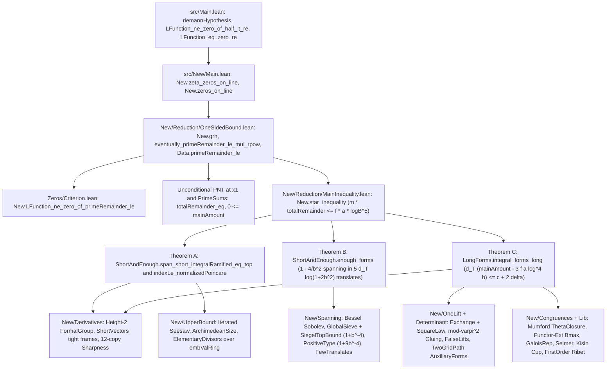

# Book-Proof Blueprint & Dependency Map of the Lean 4 GRH Proof

> **Scope & Provenance:** Complete human-readable mathematical synthesis of the Apache-2.0 condensed `grh` edition of [`leanprover-community/riemann-hypothesis`](https://github.com/leanprover-community/riemann-hypothesis) (`main` @ `7c4ccbd64d`, `802` `src/` files, Lean `v4.37.0-rc1`, `TauCeti` `2a9233e5be`), synthesized from the five file-and-line verified deep dives ([`deep_dives/README.md`](deep_dives/README.md)) and the whole-repository architectural audit ([`dossiers/whole_proof_architecture_and_megawins.md`](dossiers/whole_proof_architecture_and_megawins.md), [`dossiers/ribet_first_order_and_galois_rep.md`](dossiers/ribet_first_order_and_galois_rep.md)).
> **Hygiene Notice:** This exposition contains **zero** redistributed `.lean` proof bodies—only public declaration names, verified file paths, mathematical formulas, and original prose.

---

## Executive 60-Second Summary: Why the Proof Works

Classical attempts to prove the Generalized Riemann Hypothesis (GRH) via Landau's one-sided oscillation lemma fail in two places: (1) potential real Siegel zeros produce competing negative polar residues, and (2) bounding an analytic prime-power remainder via $p$-adic divisibility of a single CM theta jet hits an **archimedean-excess wall** (`directionAmount > 0`, where Stirling/period growth outweighs formal-group $p$-adic divisibility).

The Lean 4 `grh` proof overcomes both walls in a single interlocking architecture:

1. **Siegel-zero evasion (`OneSidedBound.lean`, `Zeros/Criterion.lean`):** Induce a putative zero $\rho$ ($\operatorname{Re} \rho > \beta > 1/2$) of $L(s,\chi)$ to modulus $q_0 = 18480 q$, choose a prime $d \equiv q_0/2 - 1 \pmod{q_0}$ such that **no quadratic twist** $\psi \cdot (\frac{\cdot}{d})$ vanishes in the finite box $\{\operatorname{Re} s \ge \beta,\, |\operatorname{Im} s| \le |\operatorname{Im} \rho|\}$, and count **inert primes** in $K = \mathbb{Q}(\sqrt{-d})$ via the nonnegative weight $\lambda(n) = (1 - (\frac{n}{d}))\Lambda(n)\mathbf{1}_{n \equiv 1 \pmod{q_0}}$. All untwisted polar residues sum with sign $(x(1-x))^{-1} \ge 0$ on $(\beta, 1]$, reducing GRH to a **one-sided** bound $R_{q_0}(x) \le A x^{-1/2 + \varepsilon}$.
2. **The `(⋆)` covolume cancellation inequality (`MainInequality.lean`):** Rather than bounding one theta jet, map a near-basis ($n \ge (1 - 4/b^2) d_T$) of good cusp forms on an indefinite unitary group $U(Y_0)$ through a chain of $m \asymp \sqrt{x}$ theta lifts over $E = K(\zeta_{q_1})$ into definite $U(Y_m)$. Compare **upper** and **lower** bounds on the twisted Arakelov covolume $(V + 2\delta)/d_T$. Both sides contain `mainAmount = m k · directionAmount`; because `0 ≤ mainAmount` (enforced by a Behrend 3-AP-free set `bPlaces`), `mainAmount` cancels **identically**, leaving $m \cdot \mathrm{totalRemainder} \le f a \log^5 b$, hence $R_{q_0}(x) \ll x^{-1/2 + 6\varepsilon}$ from $1/m \asymp x^{-1/2}$.

---

## Part 1 — The `(⋆)` Covolume Cancellation Spine

### 1.1 End-to-End Dependency DAG (`Main.lean` ← `OneSidedBound.lean` ← `MainInequality.lean`)

### 1.2 Step-by-Step Spine Equations (`MainInequality.lean` → `OneSidedBound.lean` → `Main.lean`)

1. **Theorem B (`New.Data.enough_forms`, `src/New/Reduction/ShortAndEnough.lean:399-404`):** Produces a finite set $t \subseteq D.\mathrm{chosenGL}$ of translates covering at least a $(1 - 4/b^2)$ fraction of $d_T = D.\mathrm{targetDim} > 0$, with total source dimension $\#t \cdot \dim_{\mathbb{C}} D.\mathrm{ramifiedSourceForms} \le 5\, d_T \log(1 + 2b^2)$.
2. **Theorem A (`span_short_integralRamified_eq_top` at `:202-205` & `indexLe_normalizedPoincare` at `:324-326`):** Selects $n$ linearly independent images $y : \operatorname{Fin} n \to D.\mathrm{targetForms}$ with $(1 - 4/b^2) d_T \le n \le d_T$ such that:
   - **Covolume upper bound (`h_covolume_upper`, `MainInequality.lean:121-125`):** Each $y_i$ satisfies $\log \|\Theta_1(y_i)\|_\sigma^2 \le \mathrm{mainAmount} - m\,\mathrm{totalRemainder} + \mathrm{sizeError}$ for every $\sigma \in \operatorname{Aut}(\mathbb{C})$, where $\mathrm{sizeError} := f a \log^4 b$, giving `CovolumeLe y (n * logNormBound)`.
   - **Index upper bound (`h_index_upper`, `:127-135`):** Using $\mathrm{errorUnit} := f a \log^3 b$ and `5 · 2 = 10`, gives `IndexLe y (d_T * indexBudgetPerDim)` with $\mathrm{indexBudgetPerDim} := 10 \log(1 + 2b^2)\,\mathrm{errorUnit}$.
3. **Theorem C (`New.integral_forms_long`, `src/New/Determinant/Twist/LongForms.lean:274-277`):** Applying the Arakelov product formula (`TwistedLattice.covolume_add_index_nonneg`) to $y$ completed by $n' = d_T - n \le \frac{4}{b^2} d_T$ auxiliary forms gives the covolume-index lower bound (`MainInequality.lean:138-141`):
   $$d_T (\mathrm{mainAmount} - 3\,\mathrm{sizeError}) \le n(\mathrm{mainAmount} - m\,\mathrm{totalRemainder} + \mathrm{sizeError}) + 2 d_T \cdot \mathrm{indexBudgetPerDim}.$$
4. **Behrend-Enforced Cancellation (`MainInequality.lean:143-165`):** Because **`0 ≤ D.mainAmount`** (`D.mainAmount_nonneg`, `PrimeSums.lean:301`) and $n \le d_T$, replacing $n(\mathrm{mainAmount} + \mathrm{sizeError})$ by $d_T(\mathrm{mainAmount} + \mathrm{sizeError})$ moves in the valid direction (`h_main_comparison`), cancelling $d_T \cdot \mathrm{mainAmount}$ identically (`h_main_cancelled`):
   $$n \cdot (m \cdot \mathrm{totalRemainder}) \le d_T \cdot (4\,\mathrm{sizeError} + 2\,\mathrm{indexBudgetPerDim}).$$
   Since $4/b^2 \le 1/2$ gives $d_T \le 2 n$, dividing by $n$ proves `New.star_inequality` (`MainInequality.lean:93-94`):
   $$D.m \cdot D.\mathrm{totalRemainder} \le D.f \cdot D.a \cdot D.\logB^5.$$
5. **Extracting $x^{-1/2 + 6\varepsilon}$ (`OneSidedBound.lean:45-280`):**
   - `totalRemainder_eq` (`PrimeSums.lean:183-186`) expands $\mathrm{totalRemainder} = a\bigl(|\mathrm{bPlaces}|\,(R_{q_0}(x) - R_{q_0}(x_1)) + |\mathrm{aPlaces}|\,R_1(x_1)\bigr)$.
   - Dividing `star_inequality` by $m \cdot a \cdot |\mathrm{bPlaces}|$ and using $f = |\mathrm{aPlaces}| \cdot \varphi(q_0)$ (`f_eq_card_aPlaces_mul`, `PrimeSums.lean:89`) and $|\mathrm{aPlaces}| / |\mathrm{bPlaces}| \le \log b$ (`towerDeg_le_card_bPlaces_mul`, `AdmissibleData.lean:139`) picks up a **sixth** power of $\log b$ (`Data.primeRemainder_le`, `OneSidedBound.lean:45-79`):
     $$R_{q_0}(x) \le \frac{\varphi(q_0) \log^6 b}{m} + |R_{q_0}(x_1)| + \log b \cdot |R_1(x_1)|.$$
   - Since $\log b \le 2 x^\varepsilon$, $m \ge x^{1/2}$, and unconditional PNT at $x_1$ ($\log x_1 \ge x^{\varepsilon/12}$) bounds $|R(x_1)| \le (\log x_1)^{-B} \le x^{-2}$, we obtain $R_{q_0}(x) \le (64\varphi(q_0) + 3) x^{-1/2 + 6\varepsilon}$ (`eventually_primeRemainder_natCast_le`, `:137-169`).
   - Re-indexing $\delta = \min(1/200, \varepsilon/6)$ and passing from $\lfloor y \rfloor$ to real $y$ gives $R_{q_0}(y) \le (128\varphi(q_0) + 32) y^{-1/2 + \varepsilon}$ (`eventually_primeRemainder_le_mul_rpow`, `:213-245`), feeding `New.LFunction_ne_zero_of_primeRemainder_le` (`Zeros/Criterion.lean:41`) to prove `New.grh` (`:249`), `New.zeros_on_line` / `New.zeta_zeros_on_line` (`New/Main.lean:33,42`), and `Main.{riemannHypothesis, LFunction_ne_zero_of_half_lt_re, LFunction_eq_zero_re}` (`src/Main.lean:9,17,21`).

### 1.3 Closed-Form Exponent & Constant Ledger

All exact definitions live in `New.Parameters` (`src/New/Reduction/Data/FieldsAndPlaces.lean:73-190`), `New.Data` (`AdmissibleData.lean:74-275`), `Sizes.lean`, and `Existence.lean`.

| Constant / Parameter | Closed Form / Range | Lean Source | Why This Exact Value Is Forced |
|---|---|---|---|
| **`P.q₀`, `18480`** | $18480 = 2^4 \cdot 3 \cdot 5 \cdot 7 \cdot 11$, $q_0 = 18480 q$, $d \equiv q_0/2 - 1 \pmod{q_0}$ | `FieldsAndPlaces.lean:73-83`, `OneSidedBound.lean:254-258` | **Triple arithmetic forcing:** (1) $16 \mid q_0$ + `q₀ ∣ 2(d+1) ∧ ¬q₀ ∣ (d+1)` forces $d \equiv 7 \pmod 8$ (`instPrimeSevenModEight`, `:94-96`), splitting $2$ in $K$ for `Zeros/Criterion.lean`; (2) $3 \cdot 18480 = 11 \cdot 5040$ puts $\zeta_{5040} \in E$ (`HasPrimitiveRoot5040`, giving $i$ from $4 \mid 5040$ and $\omega = \frac{1+\sqrt{-7}}{2}$ from $7 \mid 5040$ so $E/E^+$ is finite-unramified); (3) $11 \mid 18480$ closes the gap below $13$, forcing **`13 ≤ p`** for every nonsplit prime (`thirteen_le_of_chiK_ne_one`, `:171`). |
| **`s = D.towerExp`, `2^s = m^22`** | $m = 2^{e+1} \in [\sqrt{x}, 2\sqrt{x}]$, $s = 22(e+1) \le 32\log x$ | `AdmissibleData.lean:121-129`, `Existence.lean:403-499` | **Pinched at `22`:** `CrystallineDefect.lean:203` needs `halfGap^3 ≤ (2^s)^12`. With $\mathrm{halfGap} = r^8$ and $r \le 3x^5$, $\mathrm{halfGap}^3 \le 3^{24} x^{120}$, whereas $(m^{22})^{12} \ge x^{132}$ (exponent `20` loses headroom against $3^{24}$). Also ensures $2^s > (\varrho+1)k$ and $f \ge m^{22} \approx x^{11} \gg k \approx x^5$. |
| **`l₀ s`, `towerDeg s`, `D.f`** | $l_0(s) = 3^{\lfloor \log_3 s\rfloor + 4}$, $\mathrm{towerDeg}(s) = 3 l_0(s) 2^s$, $f = \varphi(q_0)\,\mathrm{towerDeg}(s)$ | `FieldsAndPlaces.lean:99-119`, `Sizes.lean:93` | `27 s < l₀ s ≤ 81 s` keeps Behrend short arcs $a + b \le 24s < l_0$ (`CrystallineDefect.lean:207`) while staying polylogarithmic so $x_1^{3 l_0^2} \le \sqrt{b}$ (`Sizes.lean:60`). Extra factor `3` ensures $5040 \mid 3 q_0$ (`PrimeDecomposition.lean:145-150`). |
| **`x`, `x₁`, `b`** | $x^{10^6} \le x_1$, $x_1^{10^6} \le b$, $\log\log b \ge 6\log\log x_1$, $(\log b)^{100} \le x$ | `AdmissibleData.lean:105-112` | Two-sided vise: $\log b \le 2 x^\varepsilon$ bounds $\log^6 b / m \le 64 x^{-1/2 + 6\varepsilon}$, while $\log b \ge (\log x_1)^6$ beats $x_1^{3 l_0^2} \le \sqrt{b}$ and $(200 f k\,\mathrm{rd}_E)^{1000} \le b$ (`Setup.lean:137`), and $\log x_1 \ge x^{\varepsilon/12}$ makes PNT error $|R(x_1)| \le x^{-2}$. |
| **`ϱ` (`10⁵` vs `10⁸`)** | $\varrho = m/2 - 1$; `10⁵ ≤ ϱ` (`Filling`), `10⁸ ≤ ϱ` (`RealPlaceSizes`) | `LabelsAndIndexTypes.lean:246`, `Setup.lean:126`, `RealPlaceGauge.lean:321` | Stratified: adelic/unfolding needs only $10^5 \le \varrho$ (e.g., $2^{-\varrho} \ll b^{-6}$ in `idealZeta(3ϱ+4)`), while Archimedean `RealShells.lean:478,598` uses `10^8 ≤ ϱ` so $k = s + 3n + 6 \ge n^7$ clears $10^{10} n^4$. |
| **`r`, `k`, `t`, `halfGap`** | $r \in [x^5, 3x^5]$, $k = r + 1 - m$, $t = 5r$, $\mathrm{halfGap} = r^8$ | `AdmissibleData.lean:122,207-216` | `k ≥ 1000(2ϱ+2)^9 ~ x^{4.5}` (`Setup.lean:132`), `t > 11m` (`ThreeExchanges.lean:134`), `2r + 2N + 3 < 6r` (`GluingMaps.lean:918`), `500 r^3 ≤ halfGap` (`Rows.lean:510`), and `halfGap^3 ≤ (2^s)^12`. |
| **`a`, `bPlaces`, `offWeight`** | $a = x b$, `offWeight = a / x₁`, $\mathrm{towerDeg} \le |\mathrm{bPlaces}| \log b$ | `AdmissibleData.lean:139,152,222-245` | Sets $a/\kappa(\tau) = x$ on `bPlaces` and $\approx x_1$ on `aPlaces \ bPlaces` (`PrimeSums.lean:141-193`), isolating $R_{q_0}(x) - R_{q_0}(x_1)$ while Behrend lower density guarantees **`0 ≤ mainAmount`**. |
| **`M = p₀ p₁`, `N`, `-15/2 log b`** | $p_i \in [b^{10}, b^{11}]$ ($b^{19} \le M \le b^{23}$), $\log N \in [\log N_-, \log N_- + \sqrt{\log b}]$ | `AdmissibleData.lean:74-76,158-167`, `Setup.lean:151-153` | **Tightest vise in the proof:** $\log N_- = \frac{m}{f}\sum_\tau \log\kappa(\tau) + (m-1)\log\frac{M\cdot\mathrm{rd}_E}{2\pi} - \mathbf{\frac{15}{2}\log b}$. Upper bound $\log N$ makes $\mathcal{D}_{\mathrm{main}}/\mathcal{D}_{\mathrm{id}} \approx (M b^{-15/2})^{kf} b^{\pm kf/4} (\text{factorials})$, leaving $19 - \frac{15}{2} - \frac{1}{4} = 11.25 > 11$ (a **$\frac{1}{4}\log b$ slack** above $b^{11 kf}$ in `FillingAdmissible.lean:571,636`). Lower bound $\log N$ drives Archimedean cancellation in `ArchimedeanSize.lean:120`. |
| **`errorUnit`, `denominatorBudget`** | $\mathrm{errorUnit} = f a \log^3 b$, $\mathrm{denominatorBudget} = \mathrm{errorUnit}/(mk)$ | `AdmissibleData.lean:262`, `FitTwists.lean:162` | Summing over $m$ lifts and $k$ rows in `LongForms.lean:223` produces $m k \log b \cdot \mathrm{denominatorBudget} = f a \log^4 b$. |
| **`1 + 9b⁻⁴`, `4/b²`** | $\sum \|\tilde P_s\|^2 \le (1 + 9b^{-4})\mathcal{D}_{\mathrm{main}}$; rank $\ge (1 - 4/b^2) d_T$ | `MomentBounds.lean:441-446`, `ShortAndEnough.lean:361-404` | Bootstrap $M \le (1 + 4x) C + x M$ ($x = b^{-4} \le 1/10$) solves $(1-x)(1+9x) - (1+4x) = x(4-9x) \ge 0$. Rank loss splits **`2/b² + 2/b²`**: `FewTranslates` with $\varepsilon_0 = (8b^2)^{-1}$ loses $16\varepsilon_0 = 2/b^2$, and `ramifiedSourceForms` loses $\le 2/b^2$. |

---

## Part 2 — Theorems A, B, C Unified (15-Minute Research Walkthrough)

Why does a single CM theta jet fail? In `ArchimedeanSize.lean` and `PrimeSums.lean:28-30`, each weight $\kappa(\tau)$ incurs archimedean jet growth $s_\infty(\kappa) = \log \kappa! + \kappa \log(M/\Omega)$ minus $p$-adic divisibility $s_{\mathrm{fin}}(\kappa, \tau) = \sum_p 2\,\mathrm{localPrimeSum}(p, \kappa, \tau)\log p$, leaving a positive excess $\mathrm{directionAmount} = \sum_\tau (s_\infty(\kappa(\tau)) - s_{\mathrm{fin}}(\kappa(\tau), \tau)) > 0$. Over $m$ lifts of rank $k$, this creates `mainAmount = m k · directionAmount`. The proof turns this liability into a cancellation tool by evaluating the Arakelov covolume of `targetLattice` ($\Theta_1 : D.\mathrm{targetForms} \to \mathrm{Form}(Y_m)$) from both sides.

### 2.1 Theorem B: Almost-Full-Rank Spanning in `New/Spanning/` (`Deep Dive 02`)

`New/Spanning/` (80 files) proves `New.Data.enough_forms` (`src/New/Reduction/ShortAndEnough.lean:399-404`) without Kuznetsov or Harish-Chandra asymptotics:

1. **Bessel Poincaré Unfolding (`Unfolding/PoincareSeries.lean:711`, `Bessel/FillingData.lean:478`):** On the split hermitian space $Y_0$ with $\varrho$ hyperbolic planes, $k$-dimensional definite core $X_0$, and anisotropic vector $z$ ($h(z,z) = -N$), `D.filling` picks a discrete-series `BesselSystem` at each $\tau \in \Phi$ whose cutoff $W^\flat = \mathrm{besselCut}(b, W)$ satisfies a left-convolution reproducing identity (`FillingData.lean:401`). Pushing source forms on $X_0$ (level $K(M) \cap U(X_0)$) forward via `poincareMap` and normalizing gives `scaledPoincare` $P$, whose Petersson inner products unfold directly into geometric orbital block sums `amplitudeSum` (`SpanningTheorem.lean:172-182`).
2. **Near-Isometry on Good Types (`Unfolding/SquareExpansion.lean:645`, `MainTerm/BadTypes.lean:217`, `SpanningTheorem.lean:261`):** Rational elements inside the Bessel subgroup $R_0 \le \mathrm{ResidueGL}$ act as the **unitary** operator `besselTranslate` $r_\psi(s)$ (`Moments.lean:185`), while $\gamma \notin \mathrm{besselS}$ near $R_0$ contribute $\le b^{-12} \mathcal{D}_{\mathrm{id}}$. Filtering by the central idempotent $e_0$ (`goodIdempotentAbove`) over tuples of monic degree-$r$ polynomials over $\mathbb{F}_{p_i}$ loses at most $\frac{1}{2} b^{-8}$ (`bad_types_rare`), proving $\mathrm{IsNearIsometry}(e_0 \circ P, 5b^{-4})$ (`isNearIsometry_e₀_comp_scaledPoincare`).
3. **Open-Cell Main Term = $1 + O(b^{-4})$ (`MainTerm/EnergyEstimate.lean:640`, `Frames/`, `MainTerm/SiegelTopBound.lean:193-459`):** When all leading principal minors are nonzero modulo all chosen places (`IsOpenElement`), `GlobalSieve.sieve` (`GlobalSieve.lean:1145-1204`) peels off hyperbolic floors $i = 0, \dots, \varrho$ one at a time via `QuadricPlancherel` (`correlation_plancherel`, `QuadricPlancherel.lean:202`) and Fourier `wave` transforms (`exists_hasLocalBounds_of_isCutBessel`, `RealBandLimits.lean:693`). At the top floor $i = \varrho+1$, `normDensity_indicator_eq_mul` bounds discrete $X_0$-sphere sums by the coarea integral `normFiberMeasure` (`TopFloor.lean:239`), paying only `idealZeta (Ô E) (3ϱ + 4) ≤ 1 + b⁻⁶` (no quantitative Siegel–Weil mass formula). All global volumes, formal degrees, and masses telescope into $\mathcal{D}_{\mathrm{main}}$, leaving `(1 + b⁻⁴) b^(-6k |S_g|) D_main`.
4. **Off-Main Tail via Sobolev + Bordered Determinants (`Bessel/OpenCellBound.lean:921`, `RemainingTerms/Gain.lean:828`, `Sum.lean:688`):** Using discrete-series Schur bounds (`SchurBound.lean:302`) and Euclidean `sobolev_trace_cube` (`SobolevBound.lean:690`), the archimedean open-cell bound pays $P^{10^5 n^4}$ against $\mathfrak{g}(Z)^{k-1}$, crushed because $k \ge n^7$ (`RealShells.lean:160`, `ϱ ≥ 10⁸`). Pairwise Ostrowski–Taussky bordered-determinant gains (`pairDiscriminant_sq_le`) and the adelic `siegel_lemma` (`SiegelLemma.lean:528`) + submodule zeta convergence (`Count.lean:194`) crush the remaining rational tail below $b^{-30} \mathcal{D}_{\mathrm{id}}$.
5. **Positive-Type Bootstrapping & Spread Extraction (`Unfolding/MomentBounds.lean:452`, `SecondMoment/PositiveType.lean:166`, `FewTranslates.lean:333,498`):** Maximizing $M_{\max} = \max_{S_g, d} b^{6k|S_g|}\,\mathrm{fixerMass}(S_g, d)$ over fixed-line stabilizers above $p_0$, non-open elements ($\det Z_{\le l} = 0$) are trapped via abelian additive characters on $\mathbb{F}_q$ (`card_mul_sum_det_eq_zero_le`) into strictly larger stabilizer sets gaining $b^{-6k}$ per fixed place (`FixedLines.lean:320`), yielding $M_{\max} \le (1 + 4b^{-4})\mathcal{D}_{\mathrm{main}} + b^{-4} M_{\max} \implies (1 + 9b^{-4})\mathcal{D}_{\mathrm{main}}$ (`sum_hilbertSchmidtNorm_scaledPoincare_sq_le`, `SpanningTheorem.lean:274`). Hilbert–Schmidt Cauchy–Schwarz (`isSpread_of_second_moment`) then greedily extracts $t$ translates (`isSpread_goodPoincare`, `:343`), losing $2/b^2$ in `FewTranslates` and $\le 2/b^2$ when restricting to `ramifiedSourceForms`, proving `enough_forms`.
6. **Multiplicity Equality (`Multiplicities/EqualMultiplicities.lean:419`):** `targetDim_eq_finrank_goodForms_spaceW` equates $d_T = \dim \mathrm{goodForms}(W_j)$ across all inner forms $Y_0, W_1, \dots, W_m$ via a simple trace comparison with a supercuspidal test function at one split auxiliary place (`trace_eq_of_isCuspidalAt`, `:21`)—requiring zero Jacquet–Langlands.

### 2.2 Theorem A & Sharpness: Height-2 Formal Groups, 12 Copies, and Non-Noetherian Elementary Divisors (`Deep Dive 03`)

`New/Derivatives/` and `New/UpperBound/` supply both the upper covolume/index bounds (`span_short_integralRamified_eq_top`, `indexLe_normalizedPoincare` in `ShortAndEnough.lean:202,324`) and the $p$-adic sharpness attained on 12 CM copies:

1. **Height-2 CM Formal Group Divisibility (`FormalGroup/` & `Divisibility/`):** At any non-split prime $p$ ($\chi_K(p) \neq 1$, hence $p \ge 13$ via `18480 ∣ q₀`), the $\pi_p$-isogeny on the CM elliptic curve over $K = \mathbb{Q}(\sqrt{-d})$ satisfies $\theta(\pi_p z) = \theta(z)^{q_p}(1 + \pi_p H(y))$ (`exists_rescale_theta_eq_pow_mul_one_add_smul`, `FrobeniusCongruence.lean:232`), while the 3-term ODE recursion for $x(z)$ locks $\|[z^{p-1}] x(z)\|_p = 1$ (`norm_coeff_taylorVia_translatedX_eq_one`, `:431`), confirming height $2$. Rescaling by $\varpi$ of valuation $\rho_p = (p^2 - 1)^{-1}$ (inert) or $(2(p-1))^{-1}$ (ramified $p = d$) separates $\theta(\varpi z) = W(z)\exp(c_\varpi \Xi_1(z))$ (`Exponent.lean:248`, $c_\varpi = \varpi^{p+1}/p$). Using explicit coprime tight frames of length $\le (dq_1)^6$ built from nilpotency of $(d+1)/4 \bmod q_1$ (`exists_isTightFrame_coprime`, `ShortVectors.lean:292,679`), `HasNormalForm` (`NormalForm.lean:58`, `exists_hasNormalForm_jetSeries` in `Vacuum/Divisibility.lean:177`) turns Frobenius action at $-p^e$ (`partner` map, `ThetaProducts.lean:60`) into coupled monomials $\Gamma_e(z) = \sum_\tau z_\tau \overline{z}_{\tau'}$. Charging one side of each coupled pair yields `norm_schurJet_jetSeries_le_of_charges` (`Vacuum/Divisibility.lean:253`).
2. **Why `12 = 6 + 6` CM Copies Attain Sharpness (`Sharpness/`):** One copy of the CM curve cannot simultaneously cancel $\theta$'s zeros/quadratic multiplier, create coupled derivatives via $c_\varpi$, and match arbitrary residual weights $\eta$. Over $\mathbb{Z}_p$, `padicInt_sum_four_squares` (`LeastValuation.lean:261`) gives $1 + \sum_{c=1}^4 a_c^2 + 0^2 = 0$, making the 6-copy `scaledThetaProd` an invertible unit (`exists_scaledThetaProd_mem_mul_eq_one`, `:526`). On **copies `0..5`**, substituting `couplingSubst` ($z_0 = z' + z''$, $z_c = \delta_c z'$, `Couplings.lean:364`) lets $\partial_{z''}$ extract $c_\varpi = \varpi^{p+1}/p$ with $\|c_\varpi\|_p = p^{1 - 1/(p-1)} > 1$ for inert $p > 2$ (`one_lt_norm_pow_div_of_inert`), attaining the full coupled valuation; on **copies `6..11`**, `leastValLE_six_zero_of_inert` (`Cases.lean`) matches the remaining uncoupled degree $\eta$ at zero valuation loss, with `D.sparse` (`NearPairs.lean`) preventing partner collisions. Multiplying via `LeastValLE.add` on `twelveSpace` (`BoundAttained.lean:157`) and Fourier-inverting mod $\mathfrak{m}$ proves `exists_rpow_neg_localPrimeSumTotal_le_norm_coeff` (`BoundAttained.lean:456`), which injects `-directionAmount` into `TwistedValueHeights.lean:1015,1235` → `LongForms.lean:274`, matching `mainAmount` in `ArchimedeanSize.lean:187` identically.
3. **Frobenius Collision Rescue via `ElementaryDivisors/`:** Because $\Phi_a = \{\tau \equiv 1 \pmod{q_0}\}$, any inert prime $p < x_1$ with $p \not\equiv \pm 1 \pmod m$ and odd order $o_0 \le \mathfrak{r} = \lceil \log_p m \rceil$ mod $q_0$ causes self-collisions $-p^{o_0} \Phi_a = \Phi_a$. Choosing a full mark $\Lambda$ picking one prime per conjugate pair (`exists_isFullMark`, `MarkedPrimes.lean`, using `smul_eq_star_iff_of_inert`) and applying the scaled Hecke operator $Y_{\mathfrak{l}} = p^{A_{\mathfrak{l}}} T_{\mathfrak{l}, \mathfrak{r}}$ once per lift separates endpoints across $\Lambda$ vs $\overline{\Lambda}$ (`ValuationAtNonSplitPrimes.lean:152,346`). Because `embValRing` ($\mathcal{O}_{\mathbb{C}_p} \cap \mathbb{C}$) is **non-Noetherian**, `ElementaryDivisors/` replaces finite module length with `ColengthDvd` (`Colength.lean:39`), `ValuationRing` finite-rank diagonalization, Stepanov's polynomial method (`stepanov_count`, `RootLemma.lean:72`), Dixon–Anderson Pieri-cone interlacing (`det_interlacing_indicator`, `PieriCone.lean:88`; `DefectCount.lean`), and dual Schur Levi averaging (`exists_average_mem_defectConditions_and_dvd_sub`, `AveragingMap.lean:699`), proving `FrobeniusCycle.elementary_divisors` (`ElementaryDivisorTheorem.lean:1181`) with colength $\le (3 c_{\mathrm{div}} + \theta m)|X||I|$ (`MarkOperator.lean:356`, `LocalDivisibility.lean:351`).
4. **Iterated Seesaw & Gain Cancellation (`UpperBound/`):** Unfolding $Y_0 \to \dots \to Y_m$ by `SeesawIdentity` + `ArchimedeanSize.lean:187` (`mainAmount_sub_add_two_mul_sum_gain`), scaling by `invGainFactor` (`ShortAndEnough.lean:57-121`) cancels `2 ∑ gain(p) log p` identically against `mainAmount - m · totalRemainder + f a log^4 b`, proving Theorem A.

### 2.3 Theorem C, Part 1: Outer-Chain Determinant Factorization, Mod-$\varpi^2$ Gluing, False Lifts & Two-Grid Completion (`Deep Dive 04`)

`New/Determinant/` and `New/OneLift/` prove `New.integral_forms_long` (`src/New/Determinant/Twist/LongForms.lean:274-277`):

1. **Factoring $Z(\vartheta)/Z(1)$ Outside the Stable Range (`Determinant/Exchange/`, `Chain/`):** The $m$-step chain $\Theta_\vartheta : Y_0 \to Y_1 \to \dots \to Y_m$ sits below the convergent range of Rallis's inner product formula and carries $m$ distinct twists $\vartheta, \dots, \vartheta^m$. Starting from convergent triples (`RemovingPlanes.lean`, `LargeTriple.lean`), the ramified Exchange Theorem (`one_square_identity_of_isEdgeFamily`, `OneSquare.lean:983`) feeds an abstract finite `SquareLaw` (`SquareLaw.lean:194,484`) that pushes finite data along `nextDatum` across an $m \times m$ triangle (`ChainNorms.lean`, `TriangleNorms.lean:403`). Crucially, in the **adjoint** squares (`exists_squareLaw_triangleReversedLift`, `ChainNorms.lean:262-302`), equal middle ranks force `lValueProd = 1`—so no critical $L$-values leak into the adjoint factor! Dividing $Z(1)/Z(\vartheta)$ cancels all unknown twist-independent constants (`exists_div_chainDeterminant_one_eq`, `NormOfChain.lean:407`), factoring $Z(1)/Z(\vartheta)$ into $\prod_{i < j} \mathrm{quotientRatio}(i,j,\vartheta)^{-d_T}$ (height $\le d_T m^2 t x_1 \le d_T b$) times $\prod_{j=1}^m Z_j(1)/Z_j(\vartheta^j)$ (`NormOfChain.lean:432`).
2. **Mod-$\varpi^2$ Gluing & Twist Independence (`OneLift/ComparisonOperator/`):** Split each definite target $V_j = I_{r+t}$ ($t = 5r$) into $V''$ (rank $r + 9m + 1$) and $V^\circ$ (rank $t - 9m - 1$). Using Hermite normal form mod $\varpi^2$ (`DividedSplitting.exists_isGlued`, `GluedLattices.lean:793`), a fixed twist-independent lattice $\gamma$ (`= 1` at twist places $Q$) decouples $V''$ (which holds all $\vartheta$-dependence) from $V^\circ$ up to `congruenceGroup` $\bar{J}^1 \equiv 1 \pmod{\varpi}$, which acts trivially on `goodForms` (`GluingMaps.lean:441`). Applying the Exchange Identity **three times** (`ThreeExchanges.lean:226-305,1034-1060`) collapses the $(W_j, V'')$-theta series to a scalar $c'_\vartheta$ times a twist-free function $\mathsf{F}_i$, giving **`c'_\vartheta · glue_\vartheta^* ∘ Θ_{j,\vartheta} = Θ^\circ`** (`twistFactor_smul_adjoint_glue_comp`, `GluingMaps.lean:1041`). Sparse non-cuspidal peak approximation (`ProductsSpan.lean:866`) proves $\Theta^\circ$ injective (`periodLift_injective`, `GluingMaps.lean:1061`).
3. **Comparison Operator & False-Lift Vanishing (`TestedForms.lean`, `FalseLifts/`, `LiftVolumeHeight.lean:731`):** Setting $U_\vartheta = n_{\mathrm{Aut}} hk^2 \operatorname{glue}_\vartheta \operatorname{glue}_\vartheta^*$ (`comparisonOp`, `LiftVolumeHeight.lean:202`) gives $Z_j(1)/Z_j(\vartheta) = (\det(\operatorname{pr} U_\vartheta)/\det(\operatorname{pr} U_1)) \rho_\vartheta^{-d_T}$. Any "false lift" $\Xi \in \operatorname{range}(e_0) \cap \operatorname{range}(\Theta_{j,\vartheta})^\perp$ killed by $H_w(X_*)$ satisfies `descentsVanish_of_hyperplaneSumsAnnihilate` (`BottomOfTower.lean:1475`) via integral row shears `rowShear`. Climbing the hyperbolic tower $W_j \oplus \mathbb{H}^N$ (`HyperbolicPlaneStep.lean:26-111`), Witt's theorem gives boundedness and the $q$-binomial small-root maximum principle (`eq_zero_of_heckePolyOp_eq_zero`) kills all descents under the rank margin **`2r + 2N + 3 < n`** (`GluingMaps.lean:918`), proving false lifts have identically zero $U(V^\circ)$-periods (`PeriodsOfFalseLifts.lean:701`). Consequently, orthogonal projection $\mathrm{starProjection}$ onto $\operatorname{range}(\Theta_{j,1})$ is simultaneously $\sigma$-orthogonal for **every** $\sigma \in \operatorname{Aut}(\mathbb{C})$ (`normSqAt_starProjection_le`, `TestedForms.lean:604`), bounding $\det(\operatorname{pr} U_1)$, while `ClearsProjection` bounds $\det(\operatorname{pr} U_\xi)$ $\ell$-adically and a 4-block seesaw (`TwistedValueHeights.lean:723,1233`) bounds $\rho_\xi^{-1}$, yielding `heightLe_liftDeterminant_ratio` (`LiftVolumeHeight.lean:731`).
4. **Two-Grid Auxiliary Basis Completion (`Determinant/AuxiliaryForms/`, `LongForms.lean:133`):** To complete $y_1, \dots, y_n$ by $n' \le \frac{4}{b^2} d_T$ auxiliary vectors, `SpanningForms.lean:860` constructs short integral forms on the **definite** corner $\tilde{Y}^m_0$, pushes them onto $Y_0$ (`exists_isFlatRestriction_range_eq_top`, `FirstPath.lean:336`), and turns the inner-product path square-by-square (`TwoGridPath.turn_induction`, `GridPaths.lean:24`) across diagonal and off-diagonal corners (`Turns.lean`, `DiagonalTurns.lean`) to `last m` (`LastPath.lean:37`), where every space is definite! Each form costs $\le 2x_1^2 b^2 + b$, and $n' \le (4/b^2) d_T$ **cancels $b^2$** (`mul_completion_cost_le`, `LongForms.lean:133`): $n'(2x_1^2 b^2 + b) \le d_T \cdot 4(2x_1^2 + b^{-1}) \le d_T b$, leaving total loss $\le 3 d_T f a \log^4 b$.

### 2.4 Theorem C, Part 2: Kottwitz-Free Shimura, Topos-Free $p$-Adic Hodge, Galois Reps & First-Order Ribet (`Deep Dive 05` & `dossiers/ribet_first_order_and_galois_rep.md`)

1. **Mumford Theta-Null Shimura Closure (`Lib/Shimura/`):** Instead of proving Kottwitz PEL moduli representability, `UniversalFamily.lean:239-513` defines `ThetaClosure` directly as the Zariski `ReducedClosure` of complex level-`dualTorsion` theta points in $\prod \mathbb{P}^{\#T-1}$. Over every good valuation arc, 4th-power Gauss-sum reality (`sum_conj_pow_four_eq_sum_pow_four`, `GaussSums.lean:281`) forces good reduction (`MultiplicativeNorm.lean:943`) and `HasPeakCharts`. Dickson monomial stabilization (`IsCutDegree`, `FlatClosure.lean:91`) yields a flat abelian family (`exists_thetaFamily_of_points`, `FamilyFromPoints.lean:1052`), `ThetaFamilyRigidity.lean` supplies uniqueness without fine moduli, and smoothness of exact relative dimension $n - 1$ follows from a characteristic-$0$ holomorphic ball immersion (`BallImmersion.lean:116`) matched by Drinfeld's `placeTorsion` tangent upper bound (`finrank_tangent_le_card_index_sub_one`, `TangentBound.lean:746`, using `a ↦ a^i` $\mathbb{F}_q$-linearity forcing $i = q^j$).
2. **Topos-Free Cohomology & $B_{\mathrm{cris}}$-Free Crystalline Comparison (`Lib/Cohomology/`, `Lib/PadicComparison/`):** Replaces SGA 4 sites with `H N F n := Abelian.Ext N F n` on presheaves over reduced, **absolutely integrally closed** (AIC) `IsTest` / `PadicTest` (`IsCell`) test categories (`Etale/Basic.lean:105`, `TestCategory.lean:253`). Proper base change uses valuative arcs + Zorn on AIC subrings (`IsProperOver.proper_base_change`, `Theorem.lean:642`); smooth base change uses `ℙ¹` Alexander duality (`GoodPairs.lean:697`); torus-tower descent uses the one-variable `TimesBNat` Wang complex (`shortExact_wangComplex`, `ToricTower.lean:166`) and exact `almostCoeff` descent (`AlmostDescent.lean:215`). Half-Woods Hole vanishing (`ellAdicCohom.woods_hole`, `WoodsHole.lean:229`) pulls back the diagonal along a $t$-twisted square-zero graph using Noether normalization (`PointClass/LinearIndependence.lean`) instead of Poincaré duality. Finally, `CrysPeriodAlgebra` (`ComparisonMap.lean:148`) replaces Fontaine's $B_{\mathrm{cris}}$ with `Bmax = B^+[1/μ]`, intrinsic `pdIdeal = {x | ∀ n, n! ∣ x^n}`, and $\sigma = \varphi^{\max(N, 3)}$, exporting `ellAdicCohom.isCrystalline_and_linearFrob_rel` (`CrystallineFrobenius.lean:753`) and `exists_hasHodgeTateWeight` (`PeriodMap.lean:279`) to `Lib/Shimura/Eigenspace.lean:744` (`Model.exists_galois_rep`).
3. **Endoscopy-Free & Weil–Deligne-Free Galois Stack (`Lib/GaloisRep/`):** `SeedRepresentation.lean:822` (`exists_rep_of_cuspidal_type`) glues embeddings via `(n+1)^2` Chebotarev trace relations (`HasNoSmallRelations`) on the dense filter `mostFrobenii E` (`Defs.lean:213`). `AllRanks.lean:469` (`sphericalCompat_std`) reaches even ranks via **twin convergent definite theta lifts $U(n) \to U(2n+1)$** + Bézout on `PolyKillsAt` (no endoscopy!). Since GRH types are depth-zero and monodromy-free ($N = 0$), `IwahoriCompatibility.lean:541` and `LabelCompatibility.lean:496` descend from spherical to Green labels via cyclic prime-degree base change + finite Shintani lift (no LLC or Weil–Deligne).
4. **Anticyclotomic Twisting, Behrend Kisin Cups & First-Order Ribet (`New/Congruences/`):**
   - `Selmer/TwistingTheorem.lean` chooses an anticyclotomic twist $\xi_\iota$ reducing the main block's crystalline Selmer length using $Z^1, Z^2$ carry cocycles (`Lib/ClassField/`, no Poitou–Tate $H^2$).
   - Because $b \gg \ell$ breaks Fontaine–Laffaille, `Lifting/CupOrthogonalityBounds.lean:509` (`hasCupExponent_of_isTameType`) + `LocalLoss/CrystallineCocycles.lean:583` (`normLength_dualDefect_le_of_crystallineSizes`, $\ell \ge 7$) use Kummer-chart Kisin lattices, Legendre cokernel thresholds (`b_i + W + η ≤ (p - 3) a` for $p \ge 5$, `CupProductBound.lean:1146`), and Behrend 3-AP-freeness of `bPlaces` to bound dual defects.
   - To clear denominators of `u_x ≃ ψ R_x ⊕ ⊕_{e=0}^{t-1} χ_cyc^{-e}` without **Vandiver's conjecture** (`evenClasses`) or infinite Taylor–Wiles patching ($R_\infty = \mathbb{T}_\infty$), `FirstOrder/TrianglePrimes.lean:443,680` picks a fixed finite prime triangle $J$ (independent of $\nu$!) at the parity-decoupling Frobenius shift $\sigma = \delta^{\ell^\nu}(g g^c u/u^c)$, collapsing `evenClasses` in a 3-stage $\mathcal{O}[X_j]$-Fitting filtration (`FittingBlock.lean:141`). At small $\ell \le t$ (where Hensel idempotents fail), `RibetMethod.lean` uses non-commutative Cramer with `tiedNormaliser` $\rho_0 = e + (1-e)(a-1)$ (`RibetMatrices.lean:239`). Picking one large $\nu$ *after* $\#J$ is fixed, `AuxiliaryPrimeTie.lean:252` deforms the base norm to first order $\mathcal{N} = \prod_j (\mathrm{Nm}_j + \alpha_j \partial_j)$ powered by the mirabolic transfer identity $\mathrm{Ver}(g_{00}) = \det$ (`OnePrime.lean:510`) and quadratic shift $x(x+k)$ (`:817`, handling $\ell = 2$), exporting `denominatorLe_clearingBound` (`DenominatorBound.lean:1325`).

---

## Part 3 — Classical Machinery Bypassed, Simplification Roadmap & Sceptical FAQ

### 3.1 Atlas of 15 Classical Detours Bypassed

| # | Classical Machinery Bypassed | Custom Bypass in `grh` | Verified Lean Witness (`src/...`) | Sharp Constant / Margin |
|---:|---|---|---|---|
| **1** | **Kottwitz PEL moduli representability & Mumford quartic equations** | Zariski `ReducedClosure` in $\prod \mathbb{P}^{\#T-1}$ + 4th-power Gauss sums + Dickson `IsCutDegree` flatness + `ThetaFamilyRigidity` + Drinfeld tangent bound | `ThetaClosure`, `nonempty_universalFamily` (`UniversalFamily.lean:239,511`), `sum_conj_pow_four_eq_sum_pow_four` (`GaussSums.lean:281`), `finrank_tangent_le_card_index_sub_one` (`TangentBound.lean:746`) | Exact relative dim `n - 1`; `4`-th power Gauss sum; `[HasPrimitiveRoot5040 E]` (`paddedNorm ≥ 3`) |
| **2** | **SGA 4 étale / pro-étale topoi & hypercovers** | Presheaf `Abelian.Ext N F n` on reduced AIC `IsTest` and `PadicTest` (`IsCell`); Zorn valuative proper base change | `H` (`Etale/Basic.lean:105`), `IsCell` (`TestCategory.lean:253`), `IsProperOver.proper_base_change` (`Theorem.lean:642`), `isTestCohomEquiv_baseChangeTransition` (`SmoothBaseChange.lean:271`) | Zero sheafification; finite-chart `ℙ¹` Alexander duality |
| **3** | **Fontaine's $B_{\mathrm{cris}}$, $A_{\mathrm{cris}}$, multidimensional Koszul & almost-math quotients** | `Bmax = B^+[1/μ]`, intrinsic `pdIdeal = {x \| ∀ n, n! ∣ x^n}`, twisted $\sigma = \varphi^{\max(N,3)}$, one-variable `TimesBNat`, inline `almostCoeff` | `exists_crysPeriodAlgebra` (`ComparisonMap.lean:148`), `ellAdicCohom.isCrystalline_and_linearFrob_rel` (`CrystallineFrobenius.lean:753`), `shortExact_wangComplex` (`ToricTower.lean:166`), `exists_faithfullyFlat_padicTest` (`AlmostDescent.lean:215`) | $\sigma = \varphi^{\max(N,3)}$ (threshold `3` clears small-$N$ `pdIdeal` poles) |
| **4** | **Full Grothendieck–Verdier / Poincaré duality & Lefschetz trace map (Woods Hole)** | Half-Woods Hole vanishing on $t$-twisted square-zero diagonal pullback + Noether normalization point-class independence + Vandermonde | `ellAdicCohom.woods_hole` (`WoodsHole.lean:229`), `exists_diagonal_local_terms` (`FixedPointFormula.lean:36`), `linearIndepOn_hodgeTateMap_pointClass` (`PointClass/LinearIndependence.lean`) | Polynomial `t^h` coefficient isolation |
| **5** | **Relative Kuznetsov trace formula (spanning matrix coefficients)** | Direct `BesselSystem` Poincaré unfolding + `PositiveType` stabilizer bootstrapping + Hilbert–Schmidt spread | `petersson_poincare` (`PoincareSeries.lean:711`), `sum_hilbertSchmidtNorm_scaledPoincare_sq_le` (`SpanningTheorem.lean:274`), `isSpread_of_second_moment` (`FewTranslates.lean:333`), `enough_forms` (`ShortAndEnough.lean:399`) | **`1 + 9b⁻⁴`** second moment; **`4/b²`** (`2/b² + 2/b²`) spanning loss |
| **6** | **Arthur–Selberg trace formula, Jacquet–Langlands & endoscopy** | Split-cuspidal simple trace comparison (`EqualMultiplicities`) + twin definite theta lifts $U(n) \to U(2n+1)$ + Bézout (`AllRanks`) | `targetDim_eq_finrank_goodForms_spaceW` (`EqualMultiplicities.lean:419`), `sphericalCompat_std` (`AllRanks.lean:469`), `ThetaLift.lean:437` | `n_m = k + m(5r+1)` vs single split auxiliary place |
| **7** | **Harish-Chandra $(\mathfrak{g}, K)$-modules, Paley–Wiener & stationary phase** | Discrete-series convolution reproducing identity + Schur Lie-derivative bound + Euclidean `sobolev_trace_cube` on `gramSection` | `hasSchurBound_of_convolve_eq` (`SchurBound.lean:302`), `lintegral_gramSection_integral_le` (`SobolevBound.lean:690`), `exists_isOpenCellBound` (`OpenCellBound.lean:921`) | `k - 1` (`k ≥ n⁷`, `ϱ ≥ 10⁸`) crushes Sobolev `10⁵ n⁴` |
| **8** | **Quantitative Siegel–Weil formula & Beurling–Selberg minorants** | Floor-by-floor `QuadricPlancherel` + `GlobalSieve` + coarea `normFiberMeasure` integral on top-floor spheres | `GlobalSieve.sieve` (`GlobalSieve.lean:1145`), `correlation_plancherel` (`QuadricPlancherel.lean:202`), `linkSecondMoment_isOpenElement_le` (`EnergyEstimate.lean:640`), `SiegelTopBound.lean:193-459` | Exact leading constant **`1`** (`idealZeta(3ϱ+4) ≤ 1 + b⁻⁶`, total `1 + b⁻⁴`) |
| **9** | **Regularized Siegel–Weil / Rallis inner product below convergent range** | Convergent ramified `Exchange` + finite `SquareLaw` (`nextDatum`) + `IsTriangle` determinant factorization | `one_square_identity_of_isEdgeFamily` (`OneSquare.lean:983`), `SquareLaw.sum_eq_nextDatum` (`SquareLaw.lean:194`), `exists_div_chainDeterminant_one_eq` (`NormOfChain.lean:407`) | Equal middle ranks cancel `lValueProd = 1` in adjoint squares (`ChainNorms.lean:299`) |
| **10** | **Local doubling zeta integrals & multiplicity-one at level $J_\vartheta$** | Mod-$\varpi^2$ lattice gluing + `ThreeExchanges` ($c'_\vartheta \operatorname{glue}_\vartheta^* \Theta_{j,\vartheta} = \Theta^\circ$) + `FalseLifts` small-root max principle + `TwoGridPath` transfer | `exists_isGlued` (`GluedLattices.lean:793`), `twistFactor_smul_adjoint_glue_comp` (`GluingMaps.lean:1041`), `eq_zero_of_heckePolyOp_eq_zero` (`HyperbolicPlaneStep.lean:81`), `exists_integral_lowerChainUpTo_eq_lastPathPeriod` (`SpanningForms.lean:489`) | **`2r + 2N + 3 < n`** (`n = 6r`, `N = r + 9m + 1`) for $q^{m'+1}\lvert X_*\rvert \le 1$ |
| **11** | **1-curve CM theta cancellation & dual-lattice Gram–Schmidt** | **`12`-copy (`6+6`)** Lagrange 4-squares `scaledThetaProd` unit + `couplingSubst` + nilpotent $(d+1)/4 \bmod q_1$ tight frames | `padicInt_sum_four_squares`, `exists_scaledThetaProd_mem_mul_eq_one` (`LeastValuation.lean:261,526`), `exists_rpow_neg_localPrimeSumTotal_le_norm_coeff` (`BoundAttained.lean:456`), `exists_isTightFrame_coprime` (`ShortVectors.lean:292`) | **`12`** copies (`6` coupling + `6` residual $\eta$); $\|\varpi^{p+1}/p\|_p > 1$ ($p > 2$ inert) |
| **12** | **Noetherian Smith Normal Form & finite module length over `embValRing`** | `ColengthDvd` + `ValuationRing` finite-rank diagonalization + Stepanov + Dixon–Anderson Pieri cone + Dual Schur Levi averaging | `ColengthDvd` (`Colength.lean:39`), `stepanov_count` (`RootLemma.lean:72`), `det_interlacing_indicator` (`PieriCone.lean:88`), `FrobeniusCycle.elementary_divisors` (`ElementaryDivisorTheorem.lean:1181`) | Colength `(3 c_div + θ m) |X| |I|`; `2 r ≤ k`; `P^{3r} ≤ a` |
| **13** | **Fontaine–Laffaille theory (fails for $b \gg \ell$)** | Kummer-chart Kisin exponent lattices + Legendre cokernel killing + Behrend 3-AP-free `bPlaces` | `killsCokernel_of_isUnramified` (`CupProductBound.lean:1146`), `hasCupExponent_of_isTameType` (`CupOrthogonalityBounds.lean:509`), `normLength_dualDefect_le_of_crystallineSizes` (`CrystallineCocycles.lean:583`) | **`b_i + W + η ≤ (p - 3) a`** ($p \ge 5$), `e·ω ≤ p - 2`, $\ell \ge 7$ |
| **14** | **Vandiver's conjecture ($\mathrm{Cl}^+$) & infinite Taylor–Wiles patching ($R_\infty = \mathbb{T}_\infty$)** | Fixed finite prime triangle $J$ with parity-decoupled shift $\sigma = \delta^{\ell^\nu}(gg^c u/u^c)$ + finite-level $\mathcal{N} = \prod(\mathrm{Nm}_j + \alpha_j \partial_j)$ + non-commutative Cramer $\rho_0$ | `TrianglePrimes.lean:443,680`, `exists_mul_prod_X_mem_fittingIdeal` (`FittingBlock.lean:141`), `AuxiliaryPrimeTie.lean:252`, `transfer_firstEntry` (`OnePrime.lean:510`), `RibetMethod.lean`, `denominatorLe_clearingBound` (`DenominatorBound.lean:1325`) | `#J` independent of $\nu$; $\ell = 2$ handled via $x(x+k)$ |
| **15** | **Poitou–Tate 9-term duality / $H^2$ & Local Langlands / Weil–Deligne $(r,N)$** | Concrete $N$-unit / $m$-th power $Z^1$ reciprocity + `mostFrobenii E` + `PolyKillsAt` + prime-degree cyclic BC + finite Shintani lift | `KummerMaps.lean:376`, `RelationsModL.lean:448`, `Selmer/TwistingTheorem.lean`, `IwahoriCompatibility.lean:541`, `LabelCompatibility.lean:496` | Depth-zero monodromy-free ($N = 0$); `X ≤ 2^(4T²⁷) h_E` (`OddSha`) |

---

### 3.2 Five-Pillar Roadmap Toward a Human "Book Proof" (~28k–45k Net LOC Deletable)

While the 802-file `grh` edition already condensed the Nov 20 archive by >98% in file count, whole-repo auditing (`dossiers/whole_proof_architecture_and_megawins.md`) separates its **15 deliberate mathematical shortcuts** (preserve!) from **~28,000–45,000 net code LOC** of local goal-search scaffolding and duplicated `Lib/` foundations. Turning the formal proof into a true human "Book Proof" follows five clean architectural pillars (all `#8312`-compliant—refactoring abstractions while preserving named intermediate theorems):

1. **Pillar 1 — Foundational `Lib/` → `TauCeti` Delegation (`−12,000 to −16,500` LOC):**
   - `Lib/ClassField/` → `TauCeti/NumberTheory/{ClassFieldTheory,Chebotarev}` (`−6,500` to `−9,000` LOC; blocked on `#7915` `DiscreteModule.H 2`), plus collapsing `GreenbergWiles/` (`−1,500` to `−2,500` LOC) once `TauCeti` Local Tate Duality lands.
   - `Lib/Adelic/{Adeles,MinkowskiTheorems}` → `TauCeti` Global Adeles / Geometry of Numbers (`−1,850` to `−2,350` LOC) + `#8581` Proposal 4 unified `IsOrthoIntegral` / `mkAdelicGL` frame-normalisation API.
   - `Lib/DiscreteSeries/` (`FockDualPair`, `WeylCharacterFormula`, `−1,300` to `−1,650` LOC) and unclaimed standalone ports (`ChowlaSelberg`, `Shintani`, `Tauberian`, `Voronoi`, `Stickelberger`, `−1,000` to `−1,300` LOC), plus deleting dead module `AbsoluteValues.lean` (`#1304`, `−130` LOC).
2. **Pillar 2 — Algebraic-Geometry & $p$-Adic Hodge Simplification (`−5,800 to −9,700` LOC):**
   - `Lib/PadicHodge/Kisin/` (`−1,500` to `−2,800` LOC): Define $S_B$ directly as `PrincipalCompletion (AdjoinRoot (C p * X - C E)) p` with $p$ inverted, deleting the 583-LOC `Bicommutant` detour and unifying `PeriodMatrixFrame`/`FrameTheorem`.
   - `Lib/Shimura/` (`−1,500` to `−2,500` LOC): Bundle 20-parameter contexts into `PELContext` / `ArcModel` and deduplicate 5-way valuative-arc boilerplate.
   - `Lib/Cohomology/PointClass/` (`−1,200` to `−2,000` LOC): Replace `GaloisClosure` + `exists_map_separating_class` with clopen connected-component splitting (`HasPartitions`), plus `WittVector` / `DerivedComplete` / `CommAlgCat` `TauCeti` wave-2 ports (`−1,600` to `−2,400` LOC).
3. **Pillar 3 — Automorphic Spanning & Seesaw Decoupling (`−5,000 to −8,300` LOC):**
   - `New/UpperBound/Seesaw/` (`−2,500` to `−4,000` LOC): Replace global `𝔸f E` idempotent surgery with placewise local lattices (diagonal off $N$, one $2\times 2$ `Bool` block at $w \mid N$) and a clean placewise `atPlace`/`supportedOn` API in `NeighbourLattice.lean`.
   - `New/Spanning/` (`−2,500` to `−4,300` LOC): Use `TauCeti` `SuccessiveMinima` + `ComplementaryMinor` in `RemainingTerms/`, bundle `AdelicLattice`, make `massIntegral` multiplicative across place partitions (`FixedLines`), and extract domain-agnostic `FewTranslates`, `PositiveType`, and `GlobalSieve` into `TauCeti`.
4. **Pillar 4 — Determinant, `AuxiliaryForms` & `FalseLifts` Simplification (`−3,500 to −4,950` LOC):**
   - `New/Appendix/DiscreteSeries/` (`−1,600` to `−2,100` LOC): Eliminate the 2,525-LOC arbitrary-codimension `PositionGroup` tower (used at only 2 sites!) via explicit Cauchy/Vandermonde weights feeding `IsLaplaceDatum.laplace_method`.
   - `New/Determinant/AuxiliaryForms/` (`−1,100` to `−1,600` LOC): Replace pointwise `EdgeTuple ϑ → ℂ` splicing in `Turns.lean` / `DiagonalTurns.lean` with monadic linear functionals `(EdgeTuple ϑ → ℂ) →ₗ[ℂ] ℂ`, and extract pure `SquareLaw`/`TriangleNorms` to `Lib/General/` or `TauCeti`.
   - `New/OneLift/FalseLifts/` (`−800` to `−1,250` LOC): Extract `ParahoricReflections.lean` to sever `BaseLevelOfLabel → BottomOfTower` and remove the `SmallCosets`/`factorialBox` detour.
5. **Pillar 5 — `Congruences` & `ElementaryDivisors` De-Slop (`−1,350 to −1,900` LOC):**
   - Execute `#6793` R3b (`OneSystem` Selmer redesign), eliminate `LabelCompatibility` `attribute [-instance]` via `Etale/Basic.lean:490` `priority := low`, replace `QuadraticStep` `decide +kernel` enumerations with 5-line CRT `ZMod.unitsEquivProd`, collapse 13-field `CharacterRows` into `TieSystem`, and extract `ColengthDvd` + `FrobeniusCycle` (`ElementaryDivisors/` core) as a clean standalone theorem over non-Noetherian `ValuationRing`s.

---

### 3.3 Sceptical-Mathematician FAQ (Exact Lean Answers)

1. **"Wait—doesn't Landau's one-sided method break down completely if real Siegel zeros exist?"**
   - **Lean answer (`Zeros/Criterion.lean:41-90`):** Yes for a single modulus, which is why `LFunction_ne_zero_of_primeRemainder_le` does **not** use one fixed remainder. Given a putative zero $\rho$ ($\operatorname{Re} \rho > \beta$), `exists_entireL_quadTwist_ne_zero` picks $d \equiv q_0/2 - 1 \pmod{q_0}$ so *every* quadratic twist $\mathrm{quadTwist}\,\chi\,d$ is zero-free on $\{\operatorname{Re} s \ge \beta,\, |\operatorname{Im} s| \le |\operatorname{Im} \rho|\}$. Then the $(1 - (\frac{n}{d}))$ weight cancels every twisted pole, leaving only untwisted poles with sign $\ge 0$ on real $x \in (\beta, 1]$ (`x * (1 - x) ≥ 0`).
2. **"Where does `directionAmount` cancel, and what stops $n < d_T$ from leaking a massive error?"**
   - **Lean answer (`MainInequality.lean:143-149`, `PrimeSums.lean:301`):** On the upper side, `ArchimedeanSize.lean:187` cancels `gain(p)` and leaves $n(\mathrm{mainAmount} - m\,\mathrm{totalRemainder} + \mathrm{sizeError})$; on the lower side, `BoundAttained.lean:456` → `LongForms.lean:274` produces $d_T(\mathrm{mainAmount} - 3\,\mathrm{sizeError})$. Replacing $n\,\mathrm{mainAmount}$ by $d_T\,\mathrm{mainAmount}$ is valid *exclusively* because Behrend's lower density bound (`towerDeg ≤ bPlaces.card * logB`) proves **`0 ≤ D.mainAmount`** (`mainAmount_nonneg`).
3. **"Does the second-moment factor $1 + 9b^{-4}$ really stay $1 + o(1)$ as rank $r \to \infty$?"**
   - **Lean answer (`SpanningTheorem.lean:274`, `MomentBounds.lean:452`, `EnergyEstimate.lean:640`):** Yes: elements in `besselS` give the unitary operator `besselTranslate` counted *once* in $\mathcal{D}_{\mathrm{main}}$ (`SquareExpansion.lean:435`), off-main $\gamma \in \Gamma^*$ decay in $M^{-k}$ (`RemainingTerms/Sum.lean:688`), open-cell floor peeling yields `1 + b⁻⁴` via `QuadricPlancherel` + coarea `normFiberMeasure` (`idealZeta ≤ 1 + b⁻⁶`), and non-open boundary matrices ($\det Z_{\le l} = 0$) are forced by `PositiveType.card_mul_sum_det_eq_zero_le` into `fixer` subgroups gaining $b^{-6k}$ per place (`FixedLines.lean:320`), bootstrapping $M \le (1 + 4x)C + xM$ to $(1 + 9b^{-4})\mathcal{D}_{\mathrm{main}}$.
4. **"Why doesn't the open-cell Sobolev exponent $P^{10^5 n^4}$ beat your discriminant gain when $\mathfrak{g}(Z) \to 0$?"**
   - **Lean answer (`OpenCellBound.lean:918-925`, `RealShells.lean:160-166`):** `pairingBoundSq` puts $(\mathfrak{g}/2)^{k-1}$ in the denominator (from the $U(\kappa)$-fiber Jacobian `fixerMeasure`), while $k \ge n^7$ (`pow_seven_le_k`) and $\varrho \ge 10^8$ (`ten_pow_le_varrho`) crush $10^5 n^4$. Whenever $\mathfrak{g}(Z)$ is small at any infinite place, `pairDiscriminant_sq_le` (`RemainingTerms/Gain.lean:828`) transfers that smallness via the product formula into a large algebraic minor.
5. **"Why 12 copies of the CM curve, and why doesn't `embValRing` break elementary divisor theory?"**
   - **Lean answer (`LeastValuation.lean:261,526`, `Couplings.lean:364`, `Colength.lean:39`):** Lagrange's 4-squares theorem in $\mathbb{Z}_p$ (`1 + a_1^2 + a_2^2 + a_3^2 + a_4^2 + 0^2 = 0`) creates a 6-copy invertible theta unit; copies `0..5` differentiate $z_0 = z' + z''$ to extract $\|\varpi^{p+1}/p\|_p > 1$ for coupled derivatives, while copies `6..11` carry residual uncoupled degree $\eta$ at zero valuation loss (`Cases.lean`). Separately, `embValRing ⊂ ℂ` is non-Noetherian, so `ColengthDvd` defines index divisibility via finite-rank transition determinants (`det m ∣ z`) + `ValuationRing` diagonalization + a $w^{c-1}$ Nakayama step (`ElementaryDivisorTheorem.lean`).
6. **"How can `c'_\vartheta · glue_\vartheta^* ∘ Θ_{j,\vartheta}` be twist-independent, and why does `starProjection` contract `normSqAt σ` for EVERY $\sigma \in \operatorname{Aut}(\mathbb{C})$?"**
   - **Lean answer (`GluingMaps.lean:458,1041`, `TestedForms.lean:579-632`):** `glueLattice` equals $1$ at all twist places $Q$ and splits mod $\varpi^2$ up to `congruenceGroup` $\bar{J}^1$ (which fixes `goodForms`), while `ThreeExchanges` collapses the $(W_j, V'')$ theta series to $c'^{-1}_\vartheta c'' \mathsf{F}_i$. Meanwhile, orthogonal projection `starProjection` contracts `normSqAt σ` for *every* $\sigma$ because `mem_sup_ker_sup_range_of_isOrthogonalToFalseLifts` decomposes $y = z + x$ with $x \in \ker(e_0) + \operatorname{range}(H_w(X_*))$—and both $e_0$ and $H_w(X_*)$ are normal for `innerAt σ` at **all $\sigma$**, making $x$ $\sigma$-orthogonal to $z$ simultaneously for every $\sigma$!
7. **"Can `ThetaClosure` really be smooth without Kottwitz representability, `Abelian.Ext` match étale cohomology without topoi, and crystallinity hold without `B_cris`?"**
   - **Lean answer (`UniversalFamily.lean:239,511`, `Etale/Basic.lean:52,105`, `ComparisonMap.lean:148`):** Yes: every point of `ThetaClosure` lies on a valuation arc of good complex points (`exists_arc_isGoodAt`) where 4th-power Gauss sums force good reduction, Dickson monomial stabilization gives flatness, and holomorphic ball immersion ($\ge n-1$) + Drinfeld `placeTorsion` tangent bound ($\le n-1$) prove smoothness. Presheaf `Abelian.Ext` agrees with sheaf cohomology because `IsTest` / `IsCell` test rings are **absolutely integrally closed** (no nontrivial finite étale covers). And `CrysPeriodAlgebra` uses `Bmax` + intrinsic `pdIdeal` + $\sigma = \varphi^{\max(N,3)}$, which suffices for `ellAdicCohom.isCrystalline_and_linearFrob_rel`.
8. **"How does `FirstOrder/` evade Vandiver's conjecture and infinite Taylor–Wiles patching even at $\ell = 2$?"**
   - **Lean answer (`TrianglePrimes.lean:443,680`, `OnePrime.lean:510,817`, `RibetMethod.lean`):** Fixing a finite prime triangle $J$ (independent of $\nu$) at the parity-decoupling shift $\sigma = \delta^{\ell^\nu}(g g^c u/u^c)$ separates odd Kummer maps ($\psi(a^c) = -\psi(a)$) from even class-group cocycles ($z(a^c) = z(a)$), killing `evenClasses` in an $\mathcal{O}[X_j]$-Fitting filtration. Choosing $\nu$ *after* $\#J$ is fixed lets one finite-level first-order norm $\mathcal{N} = \prod_j (\mathrm{Nm}_j + \alpha_j \partial_j)$ replace $N \to \infty$ patching, with `Ver(g₀₀) = det` differentiating inertia into Frobenius, quadratic shifts $x(x+k)$ avoiding division by $2$ (covering $\ell = 2$), and non-commutative Cramer with $\rho_0$ replacing Hensel idempotents.

---

## Part 4 — TCB, Independent Verification & `ShortGRH` Frontier Status

### 4.1 Four-Stage Verification Lineage (`original` → `72fead10` → Condensed `main`)

| Snapshot | Scope & License | Lean / Mathlib | Independent Verification Status |
|---|---|---|---|
| **Nov 20, 2026 (`original` `40e56bab`)** | `175,187` files, `17,374,215` lines, `1,468,414` live decls (`0` comments, no license) | Lean `v4.33.1`, Mathlib `0df444a3` | **Fully independently replayed:** `leanchecker` (`--from-export`), Rust `nanoda`, `con-leche --compare`, `con-ron`, `lean4lean`, and `Comparator v4.33.0` accepted all roots with standard axioms `[propext, Classical.choice, Quot.sound]` only (Sutherland hub & Lean FRO/Mathlib joint post, Nov 21). |
| **Nov 25, 2026 (`lsernau/grh-lean` @ `72fead10`)** | `grh/` (`802` files, ~300k code LOC, `476k` lines incl. 29.4% comments) + `grh-compact/` (`794` files, ~76k LOC), **Apache-2.0** | Lean `v4.35.0`, Mathlib `56a00585` | **Fully independently replayed:** Compiled cleanly and passed `leanchecker --fresh Main`, `Comparator v4.35.0` (`nanoda` enabled), and `con-leche` with standard axioms `[propext, Classical.choice, Quot.sound]` (`#8747`). |
| **Nov 27, 2026 (`leanprover-community/riemann-hypothesis` `main` @ `7c4ccbd64d`)** | `802` `src/` files (`22,459` extracted decls; `795` reachable from `Main`/`Statements`), **Apache-2.0**, plus **`1,636` reachable `TauCeti` modules** (`42,473` decls) | Lean `v4.37.0-rc1` (`module` system), Mathlib `31ce06ea`, `TauCeti` `2a9233e5be` | **Live CI / replay gap (`#7560`, `#8343`):** `lake build` + `PrintAxioms.lean` pass in `.github/workflows/build.yml`, **but** non-module kernel replay currently fails (`362` decls across `62` `src/New/` files hit `(kernel) deep recursion detected` from `grind` `._proof_N` terms + `formConst_mul_lintegral_le` after `#5768`/`#5769`). |

### 4.2 Open TCB & Verification Gaps on `main` (`#7560`, `#8343`, `#1304`)

1. **Non-Module Kernel Replay (`#7560`):** Under Lean `v4.37.0-rc1`'s `module` system, `.olean` files omit private proofs (stored in `.olean.private`). Currently `.github/workflows/build.yml` runs only `lake build` and `scripts/PrintAxioms.lean`, neither of which replays proofs in a non-module kernel or checks the `1,636` reachable `TauCeti.*` modules (`42,473` decls—verified at `0` failures in `#7560` comment checks). Two competing PRs (`#8358`, `#9402`) fix the `23` failing `src/New/` proof files (awaiting maintainer decision on `grind` expansion policy); once resolved, a standalone `scripts/` checker covering `Main` **and** `TauCeti` (plus `.inductInfo`/`.opaqueInfo`/duplicate-name replay parity with `Lean.Kernel.Environment.replay`) closes the CI gap.
2. **Silent Statement-Term Drift (`#8343`):** Import-order edits can silently alter `80–114` elaborated declaration terms via Mathlib typeclass tie-breaking without failing compilation. PR `#9329` introduces an opt-in `scripts/CompareDecls.lean` comparator; automating statement-hash diffing prevents TCB statement drift (`Statements.lean`, `Challenge.lean`).
3. **Dead-Module & Duplicate Cleanup (`#1304`, `#4666`):** On `7c4ccbd64d`, `7` of `802` `src/` modules are unreachable from `Main` + `Statements` (`6` already targeted by `#9409`; only `src/Lib/ClassField/Places/AbsoluteValues.lean` remains unclaimed).

### 4.3 Active `TauCeti` `ShortGRH` Upstreaming Frontier

In parallel with `riemann-hypothesis` cleanup, `TauCetiProject/TauCeti` (`GRH-targets.md`: `3,796` targets across `131` roadmaps, including `906` `ShortGRH` targets across `25` sub-roadmaps) is actively upstreaming the proof's reusable mathematical library (`343+` `ShortGRH` PRs). While analytic endpoints (`OneSidedPrimeSumBoundsAndAdmissibleData`, `ZeroFreeRegionsAndPrimesInShortWindows`, `DivisibilityOfThetaDerivatives`, `CompositeThetaLiftsAndShortForms`) have heavy PR traffic, the **core automorphic, unitary-group, and arithmetic-geometry spines remain wide open**:

| Wide-Open `ShortGRH` Sub-Roadmap | Transitive Unlocks / `serves:` | High-Leverage Entry Targets (`0`-Collision Spine) |
|---|---|---|
| **`AdelicUnitaryGroupsAndAlgebraicModularForms`** | **`434` unlocks** (`§3.1` has `9` `serves:`, #1 node in DAG) | `§7.1` (`LevelAlgebra`, PR `#47152`), `§7.12(a)` (`LineDeterminant`, 0 local deps), `§7.4` (`FibreIntegral`), `§7.6(a)` (`IsotropicStabilizer`) |
| **`WeilRepresentationsOnBanachSpacesOfData`** | **`331` unlocks** (`62` items, only `1/2` PRs) | `§3.6` + `Adelic §§2.2–2.3` (`PeriodicFourier` via `IsDualFamily` + `OrbitCutoff`) |
| **`NormsOfThetaLiftsAndExchangeIdentities`** | **`51` `serves:`** (`0` open/merged PRs!) | `§1.5` (`BiHermitianProjection` from `TestedForms.lean`), `§7.5(a)–(c)` (`CompressionDet` from `LiftVolumeHeight.lean`) |
| **`SiegelWeilAndRallisFormulasOnUnitaryGroups`** | **`84` unlocks, `46` `serves:`** (`7` `needs: none` leaves) | `§2.1` (complete splittings, Lagrangians, zero terms), `§3.3` (`InvPowLaplace`) |
| **`AbelianSchemesWithThetaStructuresAndTheirCohomology`** | **`286` unlocks** (`0/3` PRs) | `§1.1` (`needs: none`), gating CM lattice theta & `GaloisRepresentationsOfUnitaryEigenforms` (`61` `serves:`, #1 served) |
| **`CohomologyOfFunctorsOnTestRings` & `PadicComparisonForFunctorCohomology`** | **`113` / `81` unlocks** (`2/7` PRs) | `Cohomology §1.1` & `PadicComparison §3.1` (`needs: none`), `CrystallineRepresentationsAndKisinModules` (`144` unlocks) |
